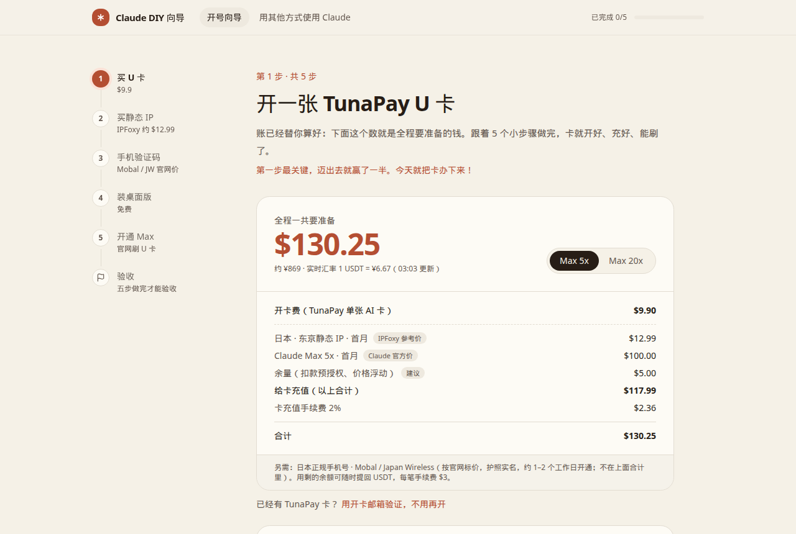
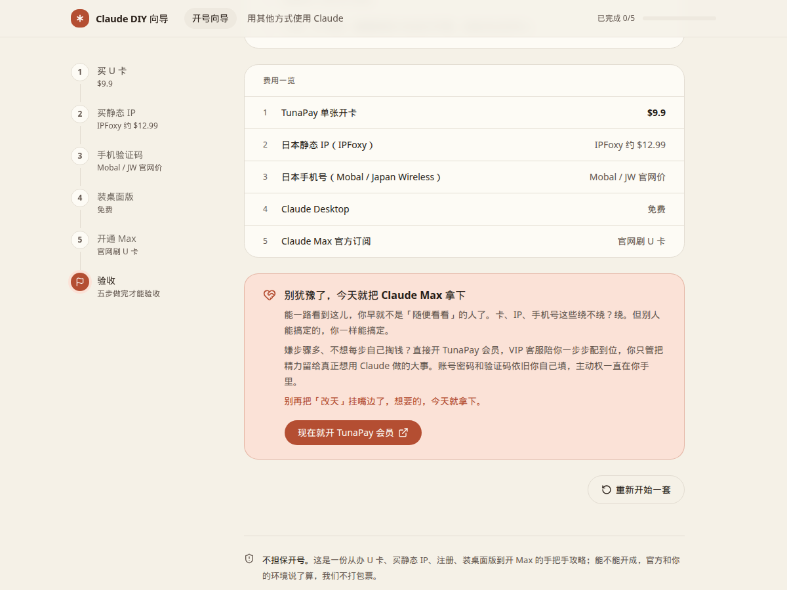

# 🧭 Claude DIY 账号向导

> 想用 Claude Max，又被「卡、IP、手机号」劝退？
> 跟着点，五步自己搞定，号和卡都在你自己手里。

### 👉 [点这里直接打开网页](https://metamm.github.io/claude-diy-wizard/)



## ✨ 五步走完

| 步骤 | 做什么 | 花多少 |
| --- | --- | --- |
| 💳 1 | 开一张 TunaPay U 卡 | $9.9 |
| 🌏 2 | 买日本静态 IP，接进 Clash Verge / BitBrowser | 约 $12.99 / 月 |
| 📱 3 | 办日本正规手机号，用自己邮箱注册 | 约 $32 起（JB Voice / Mobal 官网日元价） |
| 💻 4 | 装 Claude Desktop | 免费 |
| 🚀 5 | 用同一张卡开通 Max | 官网价 |

## 💡 亮点

- 🧮 全程账单一屏看清，Max 5x / 20x 一键切换
- ✅ 每步小项逐个打勾，做完才解锁下一步
- 🔍 自带出口 IP 检测 + 本机环境自检
- 🔀 不想开号？顶部「用其他方式使用 Claude」：Cursor、Copilot、Bedrock / Vertex
- 🤝 卡住了？TunaPay 会员有 VIP 客服陪你配好



## 📣 怎么让更多人看到

📖 **[获客小抄：在 X 上推这套方法，让 Claude 每天自动发](docs/获客指南.md)**

都是网上实测过的路子，附原帖来源。

## 🤝 看不懂？直接找我

第一次弄晕很正常。卡在哪一步，[💬 点这里 TG 找我（@tunapay2026）](https://t.me/tunapay2026)，我们一起弄通。账号始终你自己注册，密码和验证码别发给任何人。

## ⚠️ 丑话说在前头

- 🎯 不保证百分百开号成功
- 🇯🇵 按我们的经验，日本环境的成功率比新加坡环境高
- 🚫 大陆、港澳不在 Anthropic [官方支持地区](https://www.anthropic.com/supported-countries)，封号风险真实存在
- 🙅 不代注册、不卖成品号、不承诺绕过任何服务条款
- 🔒 本站不收密码和验证码，账号、卡、IP 都只在你自己手里
- 🧪 页面里的支付、开卡、买 IP 都是演示，不会真实扣款

## 🛠️ 自己跑起来

需要 [Node.js 20+](https://nodejs.org/)：

```bash
npm install
npm run dev
```

看到 `Ready` 后，在你自己电脑的浏览器里打开 `127.0.0.1:43123`。

> 💡 这个地址只在你自己电脑上跑起来才能打开；只想用的话，直接点上面的网页链接就行。

<details>
<summary>🪟 Windows 用户点这里</summary>

```powershell
npm.cmd install
npm.cmd run dev
```

用 `npm.cmd` 可以避开 PowerShell「禁止运行脚本」的报错。看到 `Ready` 后，在浏览器里打开 `127.0.0.1:43123`。

</details>

<details>
<summary>⚙️ 可选：接 IPFoxy 实时价和余额</summary>

在项目根目录建 `.env.local`：

```bash
IPFOXY_API_TOKEN=你的 API Key
IPFOXY_API_ID=你的用户 ID
```

不配也能用，会显示参考价 $12.99。

</details>

## 🌐 自己部署一份

- 📄 GitHub Pages：`npm run build:pages`，把 `out/` 推到 `gh-pages` 分支（进度存在浏览器本地）
- ▲ Vercel：打开 [vercel.com/new](https://vercel.com/new)，导入仓库，点 Deploy

---

⭐ 觉得有用，右上角点个 **Star**，让更多人少走弯路！
